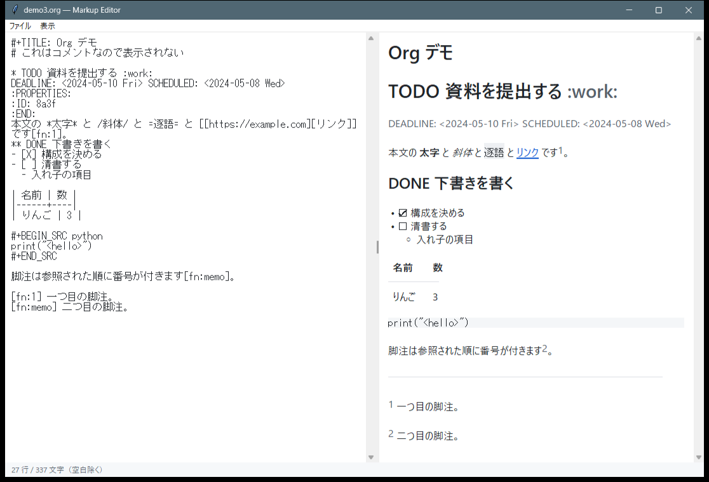

# Markup Editor

Python の標準ライブラリ（tkinter）だけで動く、Markdown / Org エディタ。Windows / macOS / Linux で使える。
左で書くと、右のプレビューにすぐ反映される。

```
python markup_editor.py [ファイル.md | ファイル.org]
```

## 画面

左のエディタで書くと、右のプレビューにすぐ反映される。見出し・強調・リスト・引用・表・コードブロックを描き分ける。

| ライト（Markdown） | ダーク（Markdown） |
|---|---|
|  |  |

Org ファイル（`.org`）も、同じ画面で編集できる。



## 必要な環境

| 項目 | 内容 |
|---|---|
| Python | 3.8 以上。コードの構文と、使っている標準ライブラリの機能は、3.8 に収まるようにしてある（3.9 以降の機能は使っていない）。ただし、実際に動かして確かめたのは **Python 3.14** だけ。 |
| tkinter | Python に含まれていること（Tk のバージョンは、確かめたのは **Tk 9.0** だけ）。Windows と macOS の公式配布版には入っている。Debian / Ubuntu 系は `sudo apt install python3-tk`、Fedora 系は `sudo dnf install python3-tkinter` で入る。pip では入らない。 |
| OS | Windows / macOS / Linux で動く作り（OS 固有の API は使わない）。実際に動かして確かめたのは **Windows 11** だけ。 |
| 画面 | デスクトップ環境が必要（GUI アプリ）。画面の無い環境（SSH だけで入るサーバなど）では起動できない。 |
| 追加のもの | **なし**。外部パッケージ（`requirements.txt` は無い）、Node.js、ビルド、外部との通信は、どれも要らない。 |
| 文字コード・フォント | ファイルは UTF-8。表示には、OS 標準の日本語フォントを使う（プレビュー本文のフォントは、表示メニューで変えられる）。 |

使えるかどうかは、次のコマンドで確かめられる。

```
python --version
python -c "import tkinter; print('Tk', tkinter.TkVersion)"
```

2 つ目が `Tk 8.6` や `Tk 9.0` のように表示されれば、tkinter は入っている。`ModuleNotFoundError` になる場合は、上の表のとおり、OS のパッケージで入れる。

## 操作

| 操作 | Windows / Linux | macOS |
|---|---|---|
| 新規 / 開く / 保存 | Ctrl+N / O / S | ⌘N / O / S |
| 名前を付けて保存 | Ctrl+Shift+S | ⌘Shift+S |
| HTML 書き出し（Markdown のみ） | Ctrl+E | ⌘E |
| 文字を大きく / 小さく | Ctrl+`+` / Ctrl+`-` | ⌘`+` / ⌘`-` |
| リンク元に戻る | Alt+← | ⌘[ |
| プレビューを 1 ページ進める / 戻す | SPACE / Ctrl+SPACE | SPACE / Ctrl+SPACE |

エディタでは、次の書式・行操作も使える（表の修飾キーは、Windows / Linux は Ctrl、macOS は ⌘）。

| 操作 | キー | 内容 |
|---|---|---|
| 太字 / 斜体 / コード | 修飾+B / I / `` ` `` | 選択範囲を囲む（Markdown は `**` `*` `` ` ``、Org は `*` `/` `~`）。選択が無ければ対を入れる |
| リンク | 修飾+K | Markdown は `[文字]()`、Org は `[[][文字]]` にして、URL の位置にカーソルを置く |
| 見出しを深く / 浅く | 修飾+Shift+] / [ | 現在行の `#`（Org は `*`）を増減する（1〜6 階層） |
| 行の複製 / 削除 | 修飾+Shift+D / K | 現在行を複製・削除する |
| 表示モード切替 | 修飾+\ | 分割 → エディタのみ → プレビューのみ |

- SPACE でのページ送りは、プレビューにフォーカスがあるときだけ効く（プレビューをクリックする。「プレビューのみ」表示では自動でフォーカスが移る）。エディタでは、SPACE は通常の文字入力。macOS の Ctrl+SPACE が入力ソース切り替えに割り当てられている場合は、システム設定側で外すと効く。

- 表示メニューで、分割 / エディタのみ / プレビューのみ、ライト / ダークを切り替える。
- 表示メニューの「プレビューのフォント…」で、プレビュー本文のフォントを選べる（名前で絞り込み、選ぶとすぐ反映、「標準に戻す」あり）。コードは等幅のまま変わらない。
- 下書き・テーマ・表示モード・フォントは `~/.markup-editor/state.json` に保存される。旧名（MD Editor）の `~/.md-editor/state.json` が残っていて、新しい保存先がまだ無いときは、そこから引き継ぐ（旧ファイルは変更しない）。
- ファイルは UTF-8 だけを扱う。BOM と改行コード（LF / CRLF）は、開いたファイルのとおりに保存する。

## Markdown と Org

ファイル名が `.org` なら Org として、それ以外は Markdown として解釈する。名前を付けて保存で拡張子を変えると、プレビューもその場で切り替わる。
Org ファイルは編集だけで、HTML への書き出しはできない（メニューが選べなくなる）。

### Markdown の書き方

見出し、段落、強調（`**` `*` `***`）、取り消し線（`~~` `~`）、コード（インライン・フェンス）、
リンク、画像、自動リンク（`https://` `www.` メール）、リスト（入れ子・番号付き・チェックリスト）、
引用、表（列寄せ）、水平線、バックスラッシュのエスケープ。

### Org の書き方

見出し（`*` の数が階層、`TODO` / `DONE`、行末の `:tag:`）、段落、
`*太字*` `/斜体/` `_下線_` `+取り消し+` `=逐語=` `~コード~`、
リンク（`[[URL][説明]]`、`[[URL]]`、画像の URL は画像）、素の `http(s)` の URL、
リスト（`-` `+` `*`、`1.` `1)`、入れ子、`[ ]` `[X]` のチェックボックス）、
`#+BEGIN_SRC` / `#+BEGIN_EXAMPLE` / `#+BEGIN_QUOTE` / `#+BEGIN_COMMENT`、表（`|---+---|` の区切り行）、
水平線（`-----`）、`#+TITLE:`、行頭が `#` のコメント、
`SCHEDULED:` / `DEADLINE:` / `CLOSED:` の行（目立たない色で表示）、
ドロワー（`:PROPERTIES:` は表示しない。ほかの `:名前:` は中身だけを表示する）、
脚注（本文の `[fn:ラベル]` を、参照された順の番号にして、定義 `[fn:ラベル] 本文` を末尾に出す）。

`#+INCLUDE`（別ファイルの取り込み）、`[fn::本文]` 形式のインライン脚注、説明リスト（`- 語 :: 説明`）は未対応。

Org の強調記号は、Emacs の Org と同じ規則で判定する。記号の前が空白か `(` `{` `'` `"` `-`、後ろが空白か `-` `.` `,` `;` `:` `!` `?` `'` `)` `}` `"` のときだけ有効になる。
日本語の文字や読点のすぐ隣（「、*太字*、」）では、強調にならない。

### リンクをクリックしたとき

プレビューのリンクをクリックすると、次のように動く。

| リンク | 動作 |
|---|---|
| `https://…`、`mailto:…` | ブラウザなどで開く |
| 相対パスの文書（Org の `[[file:org/core.org]]`、Markdown の `[a](docs/b.md)`） | このエディタで開く。「リンク元に戻る」で戻れる |
| Org の `[[file:a.org::*見出し]]`、`::#ID`、`::12`（行番号） | 開いたあと、その位置にカーソルを動かす |
| Org の `[[#ID]]`、`[[*見出し]]` | この文書の中で、その位置に動かす |

安全のため、エディタで開くのは、**自分で開いた文書のあるフォルダの下にある `.org` `.md` `.markdown` `.txt`（5MB まで）だけ**。
絶対パス、フォルダの外（`..` やシンボリックリンクで出る場合も）、画像や PDF などの別の形式は、理由を伝えて開かない。外部のプログラムは起動しない。
保存していない新規の文書では、先に保存するように伝える。

未対応の構文や制約は `AGENTS.md` の「既知の制約」を参照。

## テスト

```
python -m unittest
```

パーサーのテスト（`test_mdparser.py`、`test_orgparser.py`）と GUI のテスト（`test_gui.py`）を実行する。
GUI のテストは実際にウィンドウを開く。画面を開けない環境では、自動でスキップされる。
