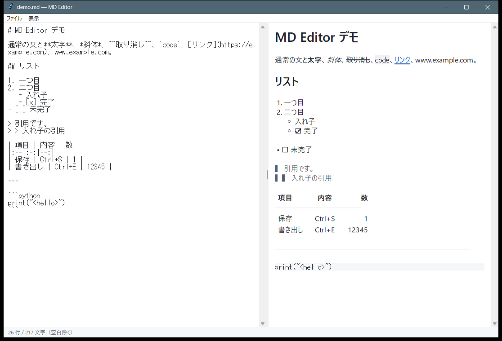
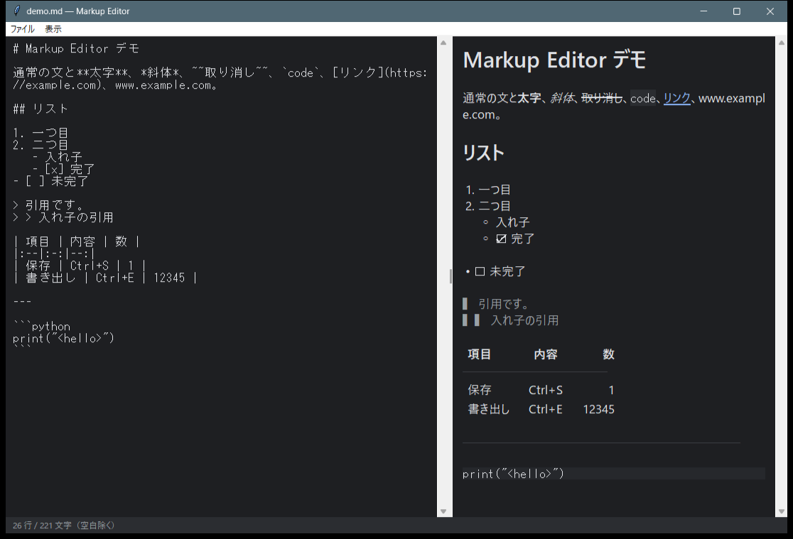

# MD Editor

Python の標準ライブラリ（tkinter）だけで動く、Markdown / Org エディタ。Windows / macOS / Linux で使える。
左で書くと、右のプレビューにすぐ反映される。

```
python md_editor.py [ファイル.md | ファイル.org]
```

## 画面

左のエディタで書くと、右のプレビューにすぐ反映される。見出し・強調・リスト・引用・表・コードブロックを描き分ける。

| ライト | ダーク |
|---|---|
|  |  |

## 要件

- Python 3.8 以上（tkinter を含むもの）。Windows と macOS の公式配布版には入っている。
  Debian / Ubuntu 系では `python3-tk` が別パッケージ。
- 外部パッケージ・外部通信は使わない。

## 操作

| 操作 | Windows / Linux | macOS |
|---|---|---|
| 新規 / 開く / 保存 | Ctrl+N / O / S | ⌘N / O / S |
| 名前を付けて保存 | Ctrl+Shift+S | ⌘Shift+S |
| HTML 書き出し（Markdown のみ） | Ctrl+E | ⌘E |
| 文字を大きく / 小さく | Ctrl+`+` / Ctrl+`-` | ⌘`+` / ⌘`-` |

- 表示メニューで、分割 / エディタのみ / プレビューのみ、ライト / ダークを切り替える。
- 表示メニューの「プレビューのフォント…」で、プレビュー本文のフォントを選べる（名前で絞り込み、選ぶとすぐ反映、「標準に戻す」あり）。コードは等幅のまま変わらない。
- 下書き・テーマ・表示モード・フォントは `~/.md-editor/state.json` に保存される。
- ファイルは UTF-8 だけを扱う。BOM と改行コード（LF / CRLF）は、開いたファイルのとおりに保存する。

## Markdown と Org

ファイル名が `.org` なら Org として、それ以外は Markdown として解釈する。名前を付けて保存で拡張子を変えると、プレビューもその場で切り替わる。
Org ファイルは編集だけで、HTML への書き出しはできない（メニューが選べなくなる）。

### Markdown の書き方

見出し、段落、強調（`**` `*` `***`）、取り消し線（`~~` `~`）、コード（インライン・フェンス）、
リンク、画像、自動リンク（`https://` `www.` メール）、リスト（入れ子・番号付き・チェックリスト）、
引用、表（列寄せ）、水平線、バックスラッシュのエスケープ。

### Org の書き方

見出し（`*` の数が階層、`TODO` / `DONE`、行末の `:tag:`）、段落、
`*太字*` `/斜体/` `_下線_` `+取り消し+` `=逐語=` `~コード~`、
リンク（`[[URL][説明]]`、`[[URL]]`、画像の URL は画像）、素の `http(s)` の URL、
リスト（`-` `+` `*`、`1.` `1)`、入れ子、`[ ]` `[X]` のチェックボックス）、
`#+BEGIN_SRC` / `#+BEGIN_QUOTE` / `#+BEGIN_COMMENT`、表（`|---+---|` の区切り行）、
水平線（`-----`）、`#+TITLE:`、行頭が `#` のコメント。

Org の強調記号は、Emacs の Org と同じ規則で判定する。記号の前が空白か `(` `{` `'` `"` `-`、後ろが空白か `-` `.` `,` `;` `:` `!` `?` `'` `)` `}` `"` のときだけ有効になる。
日本語の文字や読点のすぐ隣（「、*太字*、」）では、強調にならない。

未対応の構文や制約は `AGENTS.md` の「既知の制約」を参照。

## テスト

```
python -m unittest
```

パーサーのテスト（`test_mdparser.py`、`test_orgparser.py`）と GUI のテスト（`test_gui.py`）を実行する。
GUI のテストは実際にウィンドウを開く。画面を開けない環境では、自動でスキップされる。
